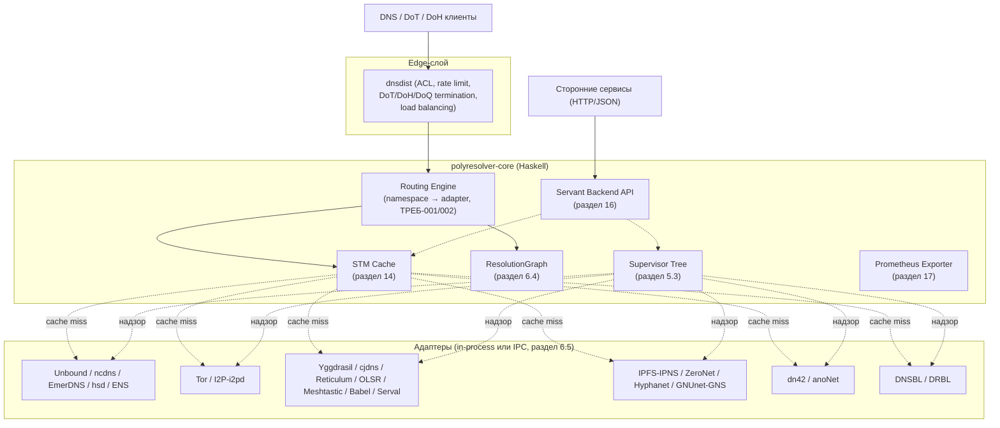

# Техническое задание

## `polyresolver` — универсальный DNS-совместимый резолвер имён для альтернативных, блокчейн- и mesh-сетей (Haskell)

**Версия документа:** 0.2 **Дата:** 17 октября 2026 г. **Статус:** рабочее ТЗ уровня Vision + SRS + SAD (см. раздел 22 о рекомендованном разделении на самостоятельные документы)

> Примечание по источнику: ссылка `https://chatgpt.com/s/t_6a58471fb1488191a76b32b92dde1c03` была запрошена инструментом получения веб-страниц; страница отдаёт только клиентский JS-каркас без содержимого диалога — из метаданных подтверждён только заголовок обсуждения, «Настройка метарезолвера». `[Не проверено]` Содержательная часть недоступна для прямой сверки по ссылке; далее в диалоге пользователь передал фрагменты этого обсуждения текстом — они учтены ниже и там, где содержат самостоятельные фактические утверждения о внешних системах (а не архитектурные предложения), повторно проверены независимым поиском либо явно помечены как непроверенные.

---

## 0. Преамбула (Панчавайава)

1. **Тезис.** `polyresolver` — система на Haskell, предоставляющая единый DNS-совместимый интерфейс к разнородным пространствам имён: классическому DNS, блокчейн-реестрам имён (Handshake, ENS, Namecoin/`ncdns`, EmerDNS), сетям анонимизации (Tor, I2P/i2pd), mesh- и overlay-сетям (Yggdrasil, cjdns, Reticulum, OLSR, Meshtastic, Babel, Serval), децентрализованным хранилищам с именующими надстройками (IPFS/IPNS, ZeroNet, Hyphanet, GNUnet/GNS), экспериментальным межсетевым даркнетам (dn42, anoNet) и репутационно-фильтрующим системам (DNSBL/DRBL).
2. **Основание.** Каждая из перечисленных систем решает задачу «имя → ресурс» собственным, несовместимым с остальными способом: консенсусный реестр, самоудостоверяющийся криптографический адрес, контентный хэш, petname-делегирование, флудинг по топологии mesh. Поддержка каждой системы отдельным клиентом порождает фрагментацию интеграционных усилий; `polyresolver` инкапсулирует эту фрагментацию на уровне типизированных адаптеров за единым протокольным фасадом.
3. **Пример.** Клиент отправляет `A example.hns` на `polyresolver`; по суффиксу `.hns` запрос маршрутизируется в Handshake-адаптер, результат нормализуется в `ResolveResult` и, если это классическая RR-запись, возвращается клиенту как обычный DNS-ответ; если результат — Ethereum-контракт с `contenthash`, он возвращается не как сфабрикованный A-record, а как типизированная структура через HTTP backend API.
4. **Применение.** Разделы 1–24 — детализация этого применения.
5. **Заключение.** `polyresolver` — исключительно уровень трансляции имён: не блокчейн-нода, не удостоверяющий центр, не VPN/прокси-клиент. Центральный архитектурный инвариант системы: **одно пространство имён → один authoritative-бэкенд, без неявного fallback** (детализация — раздел 4.1).

### Методологическое примечание по эпистемической маркировке

Пометки `[Вывод]`, `[Предположение]`, `[Не проверено]` в документе относятся исключительно к **фактическим утверждениям о существующих внешних системах** (протоколы, порты, форматы, текущий статус проектов). Архитектурные решения, сигнатуры типов и схемы конфигурации — инженерное предложение авторов ТЗ, которое по своей природе не может быть «проверено» до реализации, и поэтому не маркируется этими тремя пометками; там, где решение является одним из нескольких равно обоснованных вариантов, это оговорено явно. Нормативная лексика RFC 2119 (`MUST`/`SHOULD`/`MAY`) используется параллельно с эпистемической маркировкой и решает другую задачу: не достоверность, а обязательность требования.

---

## 1. Общие сведения

### 1.1. Наименование

`polyresolver`. Пакетное пространство имён: `polyresolver-*` (Cabal), модули верхнего уровня `Polyresolver.*`.

### 1.2. Область применения

- локальный резолвер на рабочей станции разработчика;
- шлюзовой резолвер инфраструктуры (замена связки «Unbound + набор самописных плагинов» единой системой с общим кэшем, политикой и наблюдаемостью);
- встраиваемый компонент через HTTP backend API для сторонних сервисов, которым нужен программный доступ к альтернативным пространствам имён (например, собственным проектам автора — `[Вывод]`, перенос архитектурных соглашений `Surypus`: монорепозиторий из нескольких Cabal-пакетов, STM как внутренняя шина состояния, Servant для API — предложение по аналогии, а не зафиксированное требование).

### 1.3. Термины, определения, сокращения

| Термин | Значение |
| --- | --- |
| Адаптер (Resolver instance) | Модуль, инкапсулирующий протокол конкретной системы именования и реализующий типовой интерфейс `Resolver` |
| Зона / namespace | Суффикс или предикат маршрутизации, за который отвечает ровно один authoritative-адаптер (ТРЕБ-001) |
| STM | Software Transactional Memory — механизм GHC для конкурентной работы с разделяемым состоянием без явных блокировок |
| RR | Resource Record — запись ресурса DNS |
| NVS | Name-Value Storage — сервис хранения пар имя→значение в блокчейне Emercoin |
| pTLD | Pseudo-TLD, домен верхнего уровня вне корневой зоны ICANN |
| CCIP-Read | EIP-3668 — механизм offchain-разрешения данных для смарт-контрактов Ethereum, используется в ENS |
| FCP | Freenet/Hyphanet Client Protocol — локальный API ноды Hyphanet `[Не проверено]` |
| SAM | Simple Anonymous Messaging — локальный API I2P-роутера |
| RNS | Reticulum Network Stack |
| ResolutionGraph | Внутреннее промежуточное представление (IR) цепочки разрешения запроса через несколько адаптеров подряд (раздел 6.4) |
| Supervisor tree | Дерево надзора за конкурентными процессами/потоками по модели Erlang/OTP, реализуемое поверх STM и лёгких потоков GHC (раздел 5.3) |

*(Расширенный глоссарий — Приложение А.)*

---

## 2. Назначение и цели

### 2.1. Цели

| ID | Цель |
| --- | --- |
| Ц1 | Единый DNS-фасад (UDP/TCP 53, опционально DoT/DoH/DoQ через edge-слой) поверх множества бэкендов резолюции |
| Ц2 | Расширяемость без изменений ядра: новый адаптер = новый экземпляр `Resolver` + запись маршрутизации |
| Ц3 | Изоляция отказов на уровне supervisor tree |
| Ц4 | Наблюдаемость: метрики Prometheus по каждому адаптеру/зоне/кэшу, структурированные логи |
| Ц5 | Декларативная YAML-конфигурация с hot-reload |
| Ц6 | Backend HTTP API для интроспекции и программного доступа сторонних систем |
| Ц7 | Промышленная эксплуатационная готовность: systemd, песочница, пакетирование Cabal/Nix/Guix |
| Ц8 | Диагностируемость межпространственных цепочек резолюции через `ResolutionGraph` (раздел 6.4) |

### 2.2. Не-цели

- `polyresolver` **НЕ ЯВЛЯЕТСЯ** блокчейн-нодой — обращается к уже развёрнутым внешним нодам/демонам как к зависимостям;
- **НЕ ЯВЛЯЕТСЯ** центром сертификации;
- **НЕ ЯВЛЯЕТСЯ** VPN/прокси-клиентом — для сетей, требующих собственного транспорта (Tor, I2P, Yggdrasil, cjdns, Reticulum, радио-mesh), система ожидает уже поднятый локальный демон/API;
- **НЕ ЯВЛЯЕТСЯ** реестром/регистратором имён — только читает существующие реестры.

---

## 3. Таксономия моделей разрешения имён (девятикатегорийная)

Прежде чем проектировать общий интерфейс, необходимо зафиксировать, что 20+ систем из задания не однородны по модели разрешения — попытка натянуть на все единую DNS-семантику без оговорок была бы методологической ошибкой. Классификация ниже — основа границ типов адаптеров в разделе 6.

| № | Категория | Системы | Суть модели |
| --- | --- | --- | --- |
| A | Иерархический реестр на блокчейне | Handshake (`.hns`), Namecoin/`ncdns` (`.bit`), EmerDNS/Emercoin NVS (`.emc`, `.coin`, `.lib`, `.bazar`), ENS (`.eth`) | Имя → запись в консенсусном реестре; классическая DNS-семантика (TTL, RR-типы) в основном сохраняется |
| B | Самоудостоверяющийся криптографический адрес | Tor (`.onion` v3), I2P/i2pd, Yggdrasil, cjdns (`fc00::/8`), Reticulum | Адрес выводится из публичного ключа криптографически; человекочитаемое имя — необязательная локальная надстройка |
| C | Контентная адресация + именующая надстройка | IPFS/IPNS (+DNSLink), Hyphanet (CHK/SSK/USK/**KSK**), ZeroNet (ZeroName/`.bit`) | Базовый идентификатор — хэш содержимого/ключа; имя добавляется отдельным механизмом |
| D | Петname-система с локальным корнем | GNUnet/GNS (`.alt`, `.gns.alt`) | Каждый узел администрирует свой корень, делегируя поддомены через petname-механизм; глобального корня нет по дизайну |
| E | Флудинг/анонс в mesh | OLSR (`nameservice`), Meshtastic, Serval, Babel | Имена (если есть) распространяются широковещательно по топологии, без иерархии |
| F | Реестр межсетевого даркнета | dn42, anoNet | DNS почти классический, но корень — приватная TLD-зона сообщества с отдельной anycast-инфраструктурой |
| G | Репутационно-фильтрующая надстройка | DNSBL, DRBL `[Не проверено]` | Не резолвер в строгом смысле, а классификатор/фильтр в конвейере до/после резолюции |
| H | Транспорт, ошибочно смешиваемый с резолюцией | Lantern | Прокси обхода блокировок; не выполняет функции разрешения имён, релевантен только как опциональный исходящий транспорт |
| I | Неустановленный референт | Calypso `[Не проверено]` | Система с этим названием, соответствующая контексту задачи, не идентифицирована (раздел 13.2) |

---

## 4. Требования к системе (нормативный раздел, RFC 2119)

Ключевые слова **MUST/MUST NOT/SHOULD/SHOULD NOT/MAY** интерпретируются согласно RFC 2119. Это методическое решение для повышения проверяемости требований и построения будущей матрицы трассируемости «требование → тест» (раздел 20.4); оно не является фактическим утверждением о внешней системе и не маркируется эпистемическими пометками.

### 4.1. Центральный архитектурный инвариант

- **ТРЕБ-001 \[MUST\].** Каждое пространство имён **ДОЛЖНО** иметь ровно один authoritative-адаптер; неявный fallback между конфликтующими namespace **НЕ ДОПУСКАЕТСЯ**.
- **ТРЕБ-002 \[MUST\].** Разрешение конфликта суффиксов **ДОЛЖНО** определяться явной политикой конфигурации (раздел 15.3), а не порядком регистрации адаптеров.
- **ТРЕБ-003 \[MUST\].** Для суффикса без зарегистрированного адаптера система **ДОЛЖНА** вернуть `NXDOMAIN`/эквивалент «не найдено», не прибегая к эвристическому угадыванию.
- **ТРЕБ-004 \[MUST\].** `Unbound`-бэкенд **ДОЛЖЕН** обслуживать исключительно обычное ICANN-пространство и **НЕ ДОЛЖЕН** получать маршруты на альтернативные корни.
- **ТРЕБ-005 \[SHOULD\].** Нативный режим замены корня (в первую очередь Handshake) по умолчанию **СЛЕДУЕТ** отключать, включая только для явно доверенного view/ACL.
- **ТРЕБ-006 \[MUST NOT\].** Адаптер **НЕ ДОЛЖЕН** синтезировать DNS RR-типы (прежде всего A/AAAA), для которых исходная система не предоставляет семантически корректного эквивалента; типизированные нестандартные данные (например, Ethereum-`contenthash`) возвращаются через вариант `Structured` (раздел 6.3), а не принудительным приведением к RR.

### 4.2. Функциональные требования

| ID | Требование | Keyword |
| --- | --- | --- |
| ТРЕБ-010 | DNS-фасад поддерживает UDP/TCP 53 (конфигурируемо) | MUST |
| ТРЕБ-011 | Edge-слой терминирует DoT/DoH, опционально DoQ/DoH3 | SHOULD |
| ТРЕБ-012 | Новый адаптер подключается без изменений ядра маршрутизации/кэша/API | MUST |
| ТРЕБ-013 | Backend HTTP API предоставляет интроспекцию кэша, health-статус адаптеров, принудительную инвалидацию | MUST |
| ТРЕБ-014 | YAML-конфигурация с `include`, env-overrides и hot-reload | SHOULD |
| ТРЕБ-015 | Экспорт метрик Prometheus | MUST |
| ТРЕБ-016 | Структурированное логирование (JSON/journald) | SHOULD |
| ТРЕБ-017 | Распределённая трассировка OpenTelemetry | MAY (фаза 3+) |
| ТРЕБ-018 | `ResolutionGraph` строится для каждого запроса, пересекающего ≥2 адаптера, и обнаруживает циклы делегирования | MUST |
| ТРЕБ-019 | CLI-утилита `polyresolverctl` для диагностики и управления без прямого обращения к HTTP API | SHOULD |

### 4.3. Требования к надёжности и изоляции отказов

- **ТРЕБ-020 \[MUST\].** Отказ одного адаптера **НЕ ДОЛЖЕН** деградировать обработку запросов к зонам других адаптеров — каждый вызов адаптера оборачивается границей тайм-аута/исключений в рамках supervisor-поддерева (раздел 5.3).
- **ТРЕБ-021 \[SHOULD\].** Для authoritative-адаптеров при недоступности бэкенда система **СЛЕДУЕТ** отвечать `SERVFAIL` (fail closed) без неявного serve-stale; для convenience-адаптеров serve-stale **МОЖЕТ** быть явно включён политикой.
- **ТРЕБ-022 \[SHOULD\].** Адаптеры, обращающиеся к RPC внешних демонов, **СЛЕДУЕТ** изолировать как отдельные процессы/supervisor-поддеревья.

### 4.4. Требования к безопасности (сводно; детализация — раздел 19)

- **ТРЕБ-030 \[MUST\].** RPC-порты внешних демонов **НЕ ДОЛЖНЫ** быть напрямую доступны из Интернета — только loopback/Unix-сокет.
- **ТРЕБ-031 \[MUST\].** Принцип наименьших привилегий; привязка порта 53 — через `CAP_NET_BIND_SERVICE` либо `systemd socket activation`/`dnsdist`, не через запуск от `root`.
- **ТРЕБ-032 \[SHOULD\].** Секреты не хранятся в открытом виде в основном конфиге — загрузка из отдельных файлов с ограниченными правами либо `systemd credentials`.

### 4.5. Требования к производительности

Ожидаемая задержка запроса как функция доли попаданий в кэш $h \\in \[0,1\]$:

$$ \\mathbb{E}\[L\] = h \\cdot L\_{\\text{cache}} + (1-h),\\bigl(L\_{\\text{cache}} + L\_{\\text{adapter}}\\bigr) $$

где $L\_{\\text{cache}}$ — задержка чтения `TVar` (порядка микросекунд), $L\_{\\text{adapter}}$ — задержка конкретного адаптера: от единиц миллисекунд для локального `Unbound`/`ncdns` до сотен миллисекунд для блокчейн-RPC или mesh-сетей с большим RTT. Поскольку $L\_{\\text{adapter}} \\gg L\_{\\text{cache}}$ практически для всех небазовых адаптеров, эффективность кэша доминирует в итоговой пользовательской задержке — это прямое обоснование приоритета раздела 14. `[Предположение]`: ориентир p50 cache-hit пути — 1–5 мс на локальной машине без сетевого обращения; конкретный численный SLA не является проверенным фактом и подлежит уточнению нагрузочным тестированием (раздел 20).

---

## 5. Архитектура системы

### 5.1. Трёхуровневая модель



Обоснование трёхуровневой модели: **ТРЕБ-011/4.4** требуют терминации современных транспортов (DoT/DoH/DoQ) и ACL/rate-limiting на границе сети; вынесение этой функции в выделенный edge-компонент, а не в ядро `polyresolver-core`, соответствует принципу единственной ответственности и снижает поверхность атаки на сам процесс резолвера. В качестве edge-компонента предлагается `dnsdist` — DNS-aware прокси/балансировщик проекта PowerDNS. Подтверждённые свойства (просмотр первоисточников в ходе подготовки документа):

- `dnsdist` спроектирован как слой балансировки/прокси перед авторитативными или рекурсивными серверами и по умолчанию применяет ACL, ограничивающий источники private-диапазоном RFC 1918, что препятствует случайному превращению в открытый резолвер².
- поддерживает одновременную терминацию DoT, DoH, DoQ и DoH3 на frontend-стороне и может транслировать между протоколами (например, принимать DoH и пересылать backend'у обычный UDP)³;
- поддерживает динамическую переконфигурацию через консоль, политики выбора backend'а (`leastOutstanding`, `firstAvailable`, consistent hashing и др.), packet cache и экспорт метрик через Carbon/Prometheus/HTTP API/консоль⁴;
- конфигурация — Lua и, начиная с версии 2.0, декларативный YAML (опционально с Rust-based парсером)⁵.

Разделение ответственности:

- **`dnsdist` (edge):** ACL, rate-limiting, терминация DoT/DoH/DoQ, первичная балансировка — **НЕ ВЫПОЛНЯЕТ** резолюцию и не содержит знаний о namespace-специфичной семантике;
- **`polyresolver-core` (routing/policy/cache):** маршрутизация по ТРЕБ-001/002, STM-кэш, построение `ResolutionGraph`, supervisor tree, нормализация ответов адаптеров;
- **адаптеры:** вся namespace-специфичная логика, изолированная друг от друга.

### 5.2. Состав пакетов (Cabal multi-package)

`[Вывод]`: структура — перенос по аналогии с монорепозиторием `Surypus` (несколько независимых Cabal-пакетов под единым `cabal.project`), адаптированный под задачи резолвера; это предложение, а не зафиксированное внешнее требование.

```text
polyresolver/
├── cabal.project
├── polyresolver-types/        -- общие типы: ResolveRequest, ResolveResult,
│                               --   ZonePattern, ResolutionGraph, ошибки
├── polyresolver-core/         -- Routing Engine, Supervisor Tree, STM-кэш
├── polyresolver-dns/          -- DNS wire-протокол поверх dnsext/network-dns
├── polyresolver-api/          -- Servant backend API
├── polyresolver-metrics/      -- интеграция prometheus-client
├── polyresolver-config/       -- YAML-загрузчик, схема, hot-reload
├── polyresolver-plugin-sdk/   -- Plugin SDK: ABI, IPC-клиент/сервер (раздел 6.5)
├── polyresolver-adapter-unbound/
├── polyresolver-adapter-ncdns/
├── polyresolver-adapter-emerdns/
├── polyresolver-adapter-hsd/
├── polyresolver-adapter-ens/
├── polyresolver-adapter-tor/
├── polyresolver-adapter-i2p/
├── polyresolver-adapter-mesh/      -- Yggdrasil, cjdns, Reticulum, OLSR, Meshtastic, Babel, Serval
├── polyresolver-adapter-decentweb/ -- IPFS/IPNS, ZeroNet, Hyphanet, GNUnet/GNS
├── polyresolver-adapter-darknet/   -- dn42, anoNet
├── polyresolver-adapter-filter/    -- DNSBL, DRBL
├── polyresolver-ctl/           -- CLI polyresolverctl
└── polyresolver-server/         -- исполняемый файл, собирающий всё воедино
```

### 5.3. Конкурентная модель: STM-актор + supervisor tree

`[Вывод]`: модель является инженерным предложением, вдохновлённым Erlang/OTP supervisor trees, но реализуемым идиоматическими средствами GHC (лёгкие потоки `forkIO`/`async`, разделяемое состояние через `STM`), а не портом какой-либо конкретной библиотеки — это не факт о существующей системе, а архитектурное решение.

Каждый долгоживущий конкурентный компонент (health-check цикл адаптера, IPC-соединение плагина, периодический sweep STM-кэша, экспортёр метрик) представлен как «актор» — поток, запущенный под наблюдением узла supervisor-дерева:

```haskell
data RestartStrategy
  = OneForOne      -- перезапускается только упавший актор
  | RestForOne     -- перезапускаются упавший актор и все запущенные после него
  | AllForOne      -- перезапускается всё поддерево

data ChildSpec = ChildSpec
  { childName      :: Text
  , childAction    :: IO ()
  , childRestart   :: RestartPolicy      -- Permanent | Transient | Temporary
  , childShutdown  :: ShutdownTimeout
  }

data Supervisor = Supervisor
  { supStrategy :: RestartStrategy
  , supChildren :: TVar [ (ChildSpec, Async ()) ]
  , supMaxRestarts :: Int                -- порог интенсивности рестартов в окне supPeriod
  , supPeriod      :: NominalDiffTime
  }
```

Каждый адаптер (раздел 6) регистрирует себя как `ChildSpec` в соответствующем supervisor-поддереве (**ТРЕБ-020/022**): падение HTTP/RPC-клиента одного адаптера не вызывает каскадного сбоя остальных, а перезапускается согласно `RestartPolicy` с экспоненциальной задержкой (`backoff`), что отражается в метриках `polyresolver_adapter_restarts_total` (раздел 17).

### 5.4. Поток обработки запроса

1. DNS-пакет поступает на `dnsdist`, проходит ACL/rate-limit, пересылается на `polyresolver-core` (UDP/TCP, loopback или Unix-сокет);
2. `polyresolver-dns` декодирует wire-формат (через `dnsext`, раздел 6.1), формирует `ResolveRequest`;
3. Routing Engine определяет namespace по правилу longest-suffix-match среди зарегистрированных `ZonePattern` (ТРЕБ-001/002); при конфликте — политика раздела 15.3;
4. STM-кэш проверяется по ключу `(qname, qtype, adapterId)`; при попадании — немедленный ответ, инкремент `polyresolver_cache_hits_total`;
5. При промахе — вызов `resolve` соответствующего адаптера внутри границы тайм-аута supervisor-поддерева; конкурентные идентичные запросы дедуплицируются через singleflight-механизм STM (раздел 14.3), чтобы не создавать «громовое стадо» на бэкенд;
6. Ответ адаптера нормализуется в `ResolveResult` (раздел 6.3); если ответ требует делегирования в другой адаптер (`Delegate`), шаг 3–6 повторяется, узел добавляется в `ResolutionGraph`, который проверяется на цикл (**ТРЕБ-018**) перед продолжением;
7. Результат кэшируется с TTL, производным от ответа бэкенда (адаптивная поправка — раздел 14.2), метрики записываются, ответ возвращается клиенту через `dnsdist`.

### 5.5. Сопутствующая документация (анонс; детали — раздел 22)

Полная детализация Plugin SDK ABI, модели угроз безопасности, протокола IPC между процессами и руководств администратора/разработчика выносится в отдельные документы-спутники (Vision/SRS/SAD уже объединены здесь; Plugin SDK Specification, Security Model, Protocol Specification, Developer Guide, Administrator Guide, Operations Manual, RFC/ADR Repository — раздел 22), чтобы настоящий документ оставался пригодным как рабочее ТЗ, а не разрастался в неограниченный мегадокумент.

---

## 6. Модель адаптеров

### 6.1. Выбор DNS-библиотеки для wire-уровня

Для разбора/сериализации DNS wire-формата и реализации рекурсивного/stub-клиента предлагается семейство пакетов `dnsext` (ранее часть пакета `dns` авторства Kazu Yamamoto; на момент подготовки документа разработка сконцентрирована в репозитории `iijlab/dnsext`, предоставляющем полный резолвер и stub-клиент)⁶. `[Не проверено]`: также существует более новый пакет `dnsbase`, анонсированный как «гибкий преемник» библиотеки `dns`; на момент подготовки документа независимая зрелость этого пакета не проверялась достаточно глубоко для рекомендации в качестве основного выбора — он зафиксирован как альтернатива для оценки на этапе реализации (Фаза 0). Классический пакет `dns` (устаревающий) в новых проектах не рекомендуется.

### 6.2. Типовой класс `Resolver`

```haskell
-- polyresolver-types

data ZonePattern
  = SuffixMatch Text                  -- например ".hns", ".bit", ".i2p"
  | ExactMatch  Text
  | PredicateMatch (Text -> Bool)     -- произвольная функция-предикат (например, для .onion v3 — проверка длины/алфавита)

data ResolveRequest = ResolveRequest
  { reqName      :: DNS.Domain
  , reqType      :: DNS.TYPE
  , reqClientCtx :: ClientContext      -- для view/ACL (ТРЕБ-005)
  , reqGraph     :: ResolutionGraph     -- накопленная цепочка делегирований (раздел 6.4)
  }

data HealthStatus = Healthy | Degraded Text | Unhealthy Text

class Resolver a where
  resolverName   :: a -> Text
  resolverZones  :: a -> NonEmpty ZonePattern
  resolverModel  :: a -> NamingModel     -- одна из категорий A–I (раздел 3) — для диагностики/метрик
  resolve        :: a -> ResolveRequest -> IO (Either ResolveError ResolveResult)
  healthCheck    :: a -> IO HealthStatus
  shutdown       :: a -> IO ()
```

### 6.3. `ResolveResult`: типизированный результат резолюции

Непосредственное следствие **ТРЕБ-006**: результат не может быть насильно приведён к классической DNS RR там, где исходная система не предоставляет эквивалента.

```haskell
data ResolveResult
  = Classic (NonEmpty DNS.ResourceRecord)
    -- ^ Стандартные DNS RR (A/AAAA/TXT/CNAME/…) — для адаптеров категории A
    --   (Handshake, ncdns, EmerDNS) и части категории C (DNSLink)

  | Structured StructuredRecord
    -- ^ Типизированные нестандартные данные без потери семантики:
    --   Ethereum-адрес аккаунта/контракта, ENS contenthash, I2P destination,
    --   Reticulum destination hash, KSK Hyphanet и т.п. Возвращается клиенту
    --   HTTP API как есть; в DNS-фасад проецируется в TXT только если это
    --   явно разрешено политикой конфигурации, с маркировкой "non-RR projection"

  | Delegate DelegateTarget
    -- ^ Запрос должен быть передан другому адаптеру/view (например, ENS
    --   contenthash указывает на ipfs:// → делегирование в IPFS-адаптер).
    --   Каждое делегирование — новый узел ResolutionGraph (раздел 6.4)

  | NotFound
    -- ^ Authoritative "не найдено" для данного namespace (→ NXDOMAIN)

  | TemporarilyUnavailable BackendError
    -- ^ Бэкенд недоступен; интерпретация (SERVFAIL / serve-stale) — по
    --   политике ТРЕБ-021

data StructuredRecord = StructuredRecord
  { srKind   :: StructuredKind   -- EthAddress | ContentHash | CryptoDestination | ContentKey | …
  , srValue  :: ByteString
  , srMeta   :: Map Text Text    -- произвольные доп. поля конкретной системы
  }

data DelegateTarget = DelegateTarget
  { dtZone   :: ZonePattern
  , dtName   :: DNS.Domain
  , dtReason :: Text              -- для диагностики/ResolutionGraph
  }
```

### 6.4. `ResolutionGraph`: IR для диагностики и обнаружения циклов

**ТРЕБ-018** требует построения графа цепочки резолюции для любого запроса, пересекающего ≥2 адаптера (типичный случай — многоступенчатое делегирование, например ENS → IPFS → DNSLink). Граф используется для (а) диагностики через backend API/CLI (трассировка «почему ответ именно такой»), и (б) предотвращения бесконечных циклов делегирования между адаптерами.

```haskell
data ResolutionNode = ResolutionNode
  { rnAdapter :: Text
  , rnName    :: DNS.Domain
  , rnType    :: DNS.TYPE
  , rnAt      :: UTCTime
  }

newtype ResolutionGraph = ResolutionGraph (Seq ResolutionNode)
  -- Реализован как линейная цепочка (а не общий граф) до тех пор, пока
  -- не появится адаптер с ветвящимся делегированием (на момент ТЗ — не
  -- выявлен); при необходимости тип обобщается до Data.Graph-подобной
  -- структуры без изменения внешнего интерфейса Resolver.

detectCycle :: ResolutionGraph -> ResolutionNode -> Either CycleError ResolutionGraph
-- MUST: вызывается перед каждым шагом Delegate (ТРЕБ-018); при обнаружении
-- узла (adapter, name, type), уже присутствующего в графе, резолюция
-- прерывается с ResolveError, а не зацикливается.
```

Свойство-инвариант для property-based тестирования (раздел 20.2): для любой конечной конфигурации адаптеров и любой последовательности `Delegate`-ответов, составленной генератором, `detectCycle` гарантированно завершает резолюцию за конечное число шагов, не превышающее числа зарегистрированных адаптеров.

### 6.5. Plugin SDK: внепроцессные адаптеры

Часть адаптеров (в первую очередь требующие тяжёлых или потенциально нестабильных нативных зависимостей — например, обвязка над `libunbound`, SAM-клиент I2P с длительным соединением, будущие адаптеры на других языках) **МОЖЕТ** исполняться как отдельный процесс, взаимодействующий с `polyresolver-core` по IPC, вместо линковки in-process. Рассматриваются два равно обоснованных варианта сериализации/IPC:

| Вариант | Плюсы | Минусы |
| --- | --- | --- |
| **Cap'n Proto** | Нулевое копирование при десериализации, компактная бинарная схема, естественная поддержка потоковой передачи частичных ответов (для будущих адаптеров с инкрементальными ответами — например, потоковое перечисление записей Namecoin) | `[Не проверено]`: текущая зрелость и сопровождаемость Haskell-биндингов на момент подготовки документа отдельно не проверялась — требуется оценка на этапе реализации (Фаза 2) |
| **gRPC** | Широкая кроссязыковая экосистема, удобен для адаптеров на других языках (например, обёртка над существующими Go/Python-клиентами внешних сетей), встроенная поддержка стриминга и дедлайнов | `[Не проверено]`: состояние поддерживаемости Haskell-реализации gRPC-клиента/сервера на момент подготовки документа отдельно не проверялось |

Решение между ними не фиксируется в настоящем ТЗ как окончательное — это явно обозначенный открытый вопрос Фазы 2 (раздел 23), решаемый через короткий технический spike с обеими библиотеками до выбора. В любом случае Plugin SDK предоставляет:

- версионируемый ABI запрос/ответ, изоморфный типам раздела 6.2–6.3 (`ResolveRequest`/`ResolveResult`/`HealthStatus`);
- capability negotiation при подключении плагина (заявленные зоны, поддержка потоковых частичных ответов, поддержка асинхронной отмены запроса);
- изоляцию процесса плагина как отдельного `ChildSpec` в supervisor-дереве (раздел 5.3) с собственной политикой перезапуска и, на уровне систем Linux, собственным systemd-юнитом/sandboxing-профилем (раздел 19);
- горячую регистрацию/дерегистрацию плагина без перезапуска `polyresolver-core` (согласуется с ТРЕБ-012/014).

---

## 7. Базовые («готовые») адаптеры — детальная спецификация

Эти пять адаптеров образуют Фазу 1 разработки (раздел 21) и специфицируются с максимальной детализацией, согласно прямому указанию в задании («готовые адаптеры»).

### 7.1. Unbound (категория A/база ICANN-DNS)

**Роль:** единственный бэкенд для обычного ICANN-пространства (ТРЕБ-004); сам `polyresolver` рекурсии не выполняет.

**Режим интеграции:** `polyresolver` **НЕ** линкуется с `libunbound` напрямую в базовом варианте — адаптер пересылает запрос уже запущенному демону `unbound` по loopback UDP/TCP (порт конфигурируется, типично 127.0.0.1:5335 во избежание конфликта с портом, на котором слушает edge-слой/`dnsdist`). FFI-биндинг к `libunbound` зафиксирован как опциональное усиление Фазы 3+ (снижает число сетевых прыжков ценой более сложной сборки и управления памятью через FFI).

```yaml
adapters:
  unbound:
    mode: forward         # forward | libunbound (Фаза 3+)
    upstream: "127.0.0.1:5335"
    timeout_ms: 2000
    zones: ["*"]           # catch-all для всего, не покрытого другими адаптерами
    priority: lowest        # явно самый низкий приоритет при конфликте (ТРЕБ-002)
```

### 7.2. `ncdns` — Namecoin → DNS (`.bit`, категория A)

`ncdns` — демон на Go, реализующий мост Namecoin → DNS: читает NVS-подобные записи из `namecoind` по JSON-RPC и выступает authoritative-сервером для `.bit`, опираясь на `Unbound` как recursor для остального дерева, с поддержкой DNSSEC-подписи обслуживаемой зоны⁷.

**Режим интеграции — «делегированный» (Фаза 1, по умолчанию):** `polyresolver` пересылает `.bit`-запросы уже запущенному `ncdns` по loopback, аналогично Unbound-адаптеру. Задокументированная практика самого `ncdns` — обращение к `namecoind` через loopback-only RPC с cookie-аутентификацией, без доступа к функциям кошелька на резолвер-узле⁸ — такое разделение привилегий сохраняется и рекомендуется для развёртывания `ncdns` как зависимости `polyresolver`, а не изменяется системой.

**Режим «нативный» (Фаза 2+, опционально):** прямой JSON-RPC клиент к `namecoind` (`name_show`) с собственным парсингом NVS-записей внутри `polyresolver`, минуя промежуточный DNS-прыжок через `ncdns`. Компромисс: меньшая задержка ценой дублирования логики преобразования NVS→RR, уже реализованной и сопровождаемой в `ncdns`.

```yaml
adapters:
  ncdns:
    mode: delegated          # delegated | native (Фаза 2+)
    upstream: "127.0.0.1:5333"
    zones: [".bit"]
    priority: 10
    # native-режим (Фаза 2+):
    # namecoin_rpc: {host: "127.0.0.1", port: 8336, cookie_path: "/run/namecoin/.cookie"}
```

### 7.3. EmerDNS — Emercoin NVS (`.emc`, `.coin`, `.lib`, `.bazar`, категория A)

Emercoin предоставляет сервис NVS (Name-Value Storage) общего назначения; подмножество с префиксом `dns:` используется как децентрализованный аналог DNS, поддерживающий стандартный RFC 1034/1035 UDP DNS-протокол — встроенный DNS-сервер присутствует в каждом Emercoin-кошельке и слушает запросы напрямую⁹. Задокументированные зоны включают `.lib`, `.emc`, `.coin`, `.bazar` (список может расширяться операторами сети)¹⁰. `[Вывод]`: поскольку NVS — хранилище общего назначения, в нём также исторически регистрировались записи для сторонних систем именования (например, сопоставление `i2p:` → I2P-назначение) — это релевантно как потенциальная точка пересечения с I2P-адаптером (раздел 8.2), но не меняет собственно DNS-функцию EmerDNS.

**Режим «делегированный»:** пересылка на встроенный DNS-сервер Emercoin-кошелька по loopback (порт конфигурируется оператором ноды). **Режим «нативный» (Фаза 2+):** прямой JSON-RPC клиент (`name_show`) к `emercoind` с собственной интерпретацией `dns:`-записей.

```yaml
adapters:
  emerdns:
    mode: delegated
    upstream: "127.0.0.1:5333"   # порт DNS-сервера Emercoin-кошелька, конфигурируется
    zones: [".emc", ".coin", ".lib", ".bazar"]
    priority: 10
```

### 7.4. `hsd`/`hnsd` — Handshake (`.hns`, категория A)

Handshake — блокчейн-реестр корневых зон; `hsd` (Node.js, эталонная полная нода) по умолчанию поднимает authoritative- и рекурсивный DNS-сервер — в документации основного репозитория указаны порты 5349 (authoritative) и 5350 (recursive)¹¹, тогда как в более старых форках/документации встречаются значения 15359/15360 `[Не проверено]` — расхождение не разрешено в рамках подготовки документа, конкретный порт **ДОЛЖЕН** проверяться по факту разворачиваемой версии на этапе конфигурирования. `hnsd` — облегчённый SPV-резолвер на C, также поднимающий authoritative+recursive связку поверх `libunbound` и P2P-доказательств от полных нод сети¹². `hsd` предоставляет RPC/REST API (bitcoind-подобный) для запросов уровня имени¹³.

Примечательно: сам `hsd` поддерживает механизм middleware-функций (`ns.middle`) для перехвата разрешения определённых TLD и перенаправления в сторонние системы (в документированном примере — в Namecoin)¹⁴ — это прецедент именно той задачи, которую решает `polyresolver` на уровне целой экосистемы, а не одного TLD, и служит независимым архитектурным подтверждением выбранного паттерна «адаптер на пространство имён».

**Режим «делегированный» (по умолчанию, Фаза 1):** пересылка `.hns`-запросов на локальный `hnsd`/`hsd` recursive-порт. **Режим «нативный» (Фаза 2+):** прямой RPC к `hsd` на уровне конкретного имени, минуя полный DNS-прыжок, при доверии к удалённой/локальной полной ноде.

Согласно **ТРЕБ-005**, нативный режим «подмена корня» (когда `hsd` отвечает и за обычные TLD, которых нет в Handshake, по правилам этой сети) отключён по умолчанию и доступен только явно сконфигурированному доверенному view.

```yaml
adapters:
  hsd:
    mode: delegated
    upstream: "127.0.0.1:5350"     # уточнить фактический recursive-порт развёрнутой версии
    zones: [".hns"]
    priority: 10
    native_root_view: null          # имя view, которому разрешён native-root (ТРЕБ-005); по умолчанию отключено
```

### 7.5. ENS — Ethereum Name Service (`.eth`, категория A)

ENS разрешает `.eth`-имена через пару смарт-контрактов: Registry (отображает namehash на адрес резолвера зоны) и Resolver (хранит типизированные записи — `addr()`, `contenthash()`, произвольные TXT-подобные поля); для поддоменов и wildcard-резолюции применяется ENSIP-10, offchain-данные читаются через CCIP-Read (EIP-3668) с верификацией ответа шлюза¹⁵.

**Режим «прямой» (рекомендуемый, Фаза 1):** клиент JSON-RPC к Ethereum-ноде (локальная нода либо сторонний провайдер) + ABI-кодированные вызовы Registry/Resolver; результаты — **строго** через `Structured` (ТРЕБ-006): `addr()` → `StructuredKind = EthAddress`, `contenthash()` → `StructuredKind = ContentHash`, с последующим `Delegate` в IPFS/Hyphanet/Arweave-адаптер в зависимости от схемы contenthash, если соответствующий адаптер зарегистрирован (раздел 6.3–6.4). Запрос классического RR-типа (A/AAAA) к `.eth`-имени, у которого нет семантически корректного соответствия, **ДОЛЖЕН** возвращать `NotFound`, а не изобретённый адрес.

**Режим «шлюз» (альтернатива):** HTTP-запрос к DNS-шлюзу ENS (публичные примеры — `eth.limo`, исторически также `eth.link`)¹⁶ — проще в реализации, но переносит доверие на оператора шлюза; `[Не проверено]`: актуальный операционный статус конкретных публичных шлюзов на момент эксплуатации **ДОЛЖЕН** быть проверен оператором отдельно, поскольку это быстро меняющаяся инфраструктура.

```yaml
adapters:
  ens:
    mode: direct                 # direct | gateway
    ethereum_rpc: "https://localhost:8545"   # или сторонний провайдер
    registry_address: "0x00000000000C2E074eC69A0dFb2997BA6C7d2e1e"   # [Не проверено] — сверить с актуальной документацией ENS перед использованием
    zones: [".eth"]
    priority: 10
    fabricate_a_aaaa: false        # ТРЕБ-006: запрещено по умолчанию, неизменяемо без явного override с предупреждением
```

---

## 8. Сети анонимизации

### 8.1. Tor — `.onion` v3 (категория B)

Адреса v3 (56 символов base32, выводятся из Ed25519-ключа) самоудостоверяющиеся — отдельная инфраструктура разрешения имени не требуется: «резолюция» сводится к синтаксической валидации структуры адреса и передаче транспортного запроса локальному Tor-клиенту (SOCKS5-прокси, опционально `DNSPort`). Адаптер **НЕ ДОЛЖЕН** выполнять сетевой lookup сам — только валидировать формат и проксировать факт «это валидный onion-адрес» потребителю через `Structured { srKind = CryptoDestination }`.

```yaml
adapters:
  tor:
    mode: passthrough
    socks_proxy: "127.0.0.1:9050"
    zones: [".onion"]
    priority: 10
```

### 8.2. I2P / i2pd — `.i2p` (категория B)

I2P использует «адресную книгу» (addressbook) — подписочную модель статических списков host→destination — и локальный API SAM (Simple Anonymous Messaging) для программных lookup'ов, выполняемых приложениями через команду `NAMING LOOKUP`. `i2pd` — независимая C++-реализация протокола I2P, сетевая и адресная семантика совпадает с эталонным Java-роутером, поэтому один адаптер обслуживает оба случая, различаясь только путём/портом локального SAM-сокета в конфигурации.

```yaml
adapters:
  i2p:
    mode: sam
    sam_endpoint: "127.0.0.1:7656"     # [Не проверено]: порт по умолчанию согласно общей практике I2P/SAM, сверить с конкретной установкой
    zones: [".i2p"]
    priority: 10
```

---

## 9. Mesh- и overlay-сети

Эта группа — наиболее методологически разнородная: часть систем **не имеет** канонического глобального механизма именования по дизайну (категория B/E), и адаптер в таких случаях обязан честно отражать это ограничение, а не изобретать единый реестр там, где сообщество само его не выработало.

### 9.1. Yggdrasil (категория B)

`[Не проверено]`: в ходе подготовки документа не обнаружено канонического, общепринятого глобального сервиса именования для Yggdrasil — адресация выводится криптографически из Ed25519-ключей аналогично cjdns. Адаптер реализуется как реестр статических petname-записей (локальный YAML-файл/конфигурация оператора), с явным флагом «не является глобальным DNS-эквивалентом» в метаданных ответа.

### 9.2. cjdns / Hyperboria (категория B)

Документация сообщества Hyperboria прямо фиксирует фрагментированную и нестабильную историю попыток создать DNS для сети: несколько конкурирующих систем (упоминаются `hypeDNS` и `rainflyDNS`), причём на момент соответствующих заметок разработка части из них была приостановлена, а сопровождающий одной из систем сложил полномочия, оставив DNS-слой «в состоянии перехода»¹⁷. `[Не проверено]`: актуальный статус какого-либо из этих проектов на текущий момент не проверялся и, по независимым признакам в первоисточниках, с высокой вероятностью нестабилен. Адаптер проектируется как **подключаемая точка** (аналог `DelegateTarget` на внешний, оператором указанный сервис), а не как встроенная реализация конкретного решения — архитектура не должна жёстко зависеть от того, какая DNS-инициатива Hyperboria активна на момент эксплуатации.

### 9.3. Reticulum (категория B)

Адресация Reticulum принципиально отличается от DNS-модели: `destination hash` — детерминированная функция от строки «aspects» приложения и публичного ключа identity, вычисляемая **локально**, без сетевого запроса (`RNS.Destination.hash_from_name_and_identity`)¹⁸. Собственно «разрешение» в понимании DNS здесь не требуется — задача адаптера иная: поддерживать каталог человекочитаемых petname → (identity, aspects), а доступность/маршрут до вычисленного хэша определяется отдельным протоколом анонсов RNS, не относящимся к функции именования. Адаптер реализован как слушатель анонсов (накопление `app_data` в реверс-индекс) + статический конфигурируемый реестр.

### 9.4. OLSR (категория E)

Плагин `nameservice` для `olsrd` распространяет записи вида «hostname → адрес» широковещательно по топологии OLSR в формате, подобном `/etc/hosts`, записывая результат в файл (типично `/var/run/hosts_olsr`), который может опционально обслуживаться через `dnsmasq` как мост к настоящему DNS-протоколу¹⁹. Адаптер `polyresolver` реализуется как наблюдатель за этим файлом (file-watcher) с периодическим перечитыванием и инвалидацией кэша при изменении.

### 9.5. Meshtastic (категория E, `[Не проверено]`)

LoRa-based mesh для офлайн-обмена сообщениями; узлы идентифицируются числовыми ID и короткими именами, обмен метаданными узлов возможен через Bluetooth/serial API устройства либо MQTT-мост. `[Не проверено]`: специализированного DNS-подобного механизма разрешения имён в экосистеме Meshtastic в ходе подготовки документа не обнаружено и отдельно не проверялось — архитектурное предложение (каталог, собираемый из MQTT-топика с пакетами информации об узлах) помечается как `[Предположение]`, требующее сверки с актуальной протокольной схемой Meshtastic (protobuf) непосредственно перед реализацией в Фазе 4.

### 9.6. Babel (категория E, `[Не проверено]`)

Чистый протокол маршрутизации (RFC 8966/8967) без встроенного слоя именования `[Не проверено]` — для получения человекочитаемых имён в сети, построенной на Babel, потребуется отдельная надстройка (например, mDNS/Avahi поверх полученной топологии), не являющаяся частью самого протокола маршрутизации. Адаптер Фазы 4 ограничивается ролью моста к такой внешней надстройке, если она сконфигурирована оператором.

### 9.7. Serval (категория E, `[Не проверено]`)

Serval Mesh / Serval DNA использует Subscriber ID (SID) как адрес уровня приложения; при наличии именующего слоя он, по доступным сведениям, связан с компонентом Rhizome (store-and-forward хранилище) `[Не проверено]` — точная текущая архитектура не проверялась независимо в ходе подготовки документа и зафиксирована как требующая валидации перед реализацией Фазы 4.

```yaml
adapters:
  mesh:
    yggdrasil:
      mode: static_registry
      registry_path: "/etc/polyresolver/yggdrasil-names.yaml"
      zones: [".ygg"]            # pTLD — соглашение оператора, не стандарт
    cjdns:
      mode: delegate_external
      upstream: null              # оператор указывает конкретный Hyperboria DNS-сервис, если таковой выбран
      zones: [".hype"]            # pTLD — соглашение сообщества, подлежит проверке на этапе эксплуатации
    reticulum:
      mode: announce_listener
      registry_path: "/etc/polyresolver/reticulum-names.yaml"
      zones: [".rns"]
    olsr:
      mode: hosts_watch
      hosts_path: "/var/run/hosts_olsr"
      zones: [".olsr"]
    meshtastic:        # Фаза 4, экспериментально
      mode: mqtt_directory
      enabled: false
    babel:              # Фаза 4, экспериментально
      mode: external_bridge
      enabled: false
    serval:              # Фаза 4, экспериментально
      mode: rhizome_bridge
      enabled: false
```

---

## 10. Децентрализованный веб и хранилища

### 10.1. IPFS / IPNS / DNSLink (категория C)

Два независимых механизма человекочитаемого именования: **IPNS** (мутируемый указатель, адресуемый по PeerID или отдельному ключу) и **DNSLink** (обычная TXT-запись `_dnslink.<имя>`, указывающая на `/ipfs/<CID>` либо `/ipns/<ключ>`, то есть фактически делегирование через существующий DNS). Адаптер поддерживает оба пути: прямой запрос к локальной IPFS-ноде (HTTP RPC API) для IPNS и обычный DNS-запрос TXT-записи для DNSLink с последующим `Delegate`.

### 10.2. ZeroNet (категория C)

Адреса сайтов ZeroNet — Bitcoin-подобные адреса; плагин ZeroName связывает их с человекочитаемыми `.bit`-доменами, зарегистрированными в Namecoin с ключом `zeronet`, разрешаемым либо через прямой RPC к `namecoind`, либо через распределённый «resolver site», публикующий сопоставление в собственном `data/names.json`²⁰. Поскольку это пересекается с пространством имён `.bit`, обслуживаемым адаптером `ncdns` (раздел 7.2), конфликт разрешается политикой **ТРЕБ-002**: единый `.bit`-адаптер (`ncdns`) интерпретирует ключ `zeronet` внутри уже читаемой NVS-записи и возвращает `Structured { srKind = CryptoDestination }`, а не заводится отдельный конкурирующий `.bit`-authoritative-бэкенд.

### 10.3. Hyphanet (бывший Freenet, категория C)

Проект переименован из Freenet в Hyphanet в 2023 году²¹. Типы ключей: CHK (хэш содержимого), SSK/USK (подписанное пространство/обновляемое подписанное пространство) и **KSK** (Keyword Signed Key) — единственный из четырёх типов, являющийся непосредственно человекочитаемым именем (производится от произвольной строки), тогда как CHK/SSK/USK по своей природе не человекочитаемы и не являются предметом «разрешения имени» в смысле задачи ТЗ²². Адаптер обслуживает запросы вида `<строка>.freenet`/`<строка>.hyphanet` как вычисление KSK и обращение к локальной ноде по FCP (Freenet/Hyphanet Client Protocol) `[Не проверено]`: точная текущая спецификация FCP отдельно не проверялась в ходе подготовки документа и требует сверки на этапе реализации Фазы 3.

### 10.4. GNUnet / GNS — GNU Name System (категория D)

GNS стандартизирован как экспериментальный RFC 9498 (2023)²³. Использует зарезервированный через GANA псевдо-TLD `.alt`, в частности `.gns.alt` закреплён конкретно за GNS²⁴; базовая единица — петname-зона, которую администрирует каждый узел самостоятельно, делегируя поддомены другим зонам (в том числе чужим) без глобального единого корня по дизайну; поиск чужих записей — через распределённую DHT, локальный кэш — `NAMECACHE`/`NAMESTORE`²⁵. Экосистема GNUnet предоставляет готовый шлюзовой инструмент DNS2GNS для трансляции между классическим DNS и GNS²⁶ — адаптер `polyresolver` в режиме по умолчанию делегирует на локальный `gnunet-gns`-сервис аналогично паттерну разделов 7.1–7.4, не реализуя DHT-клиент самостоятельно в Фазе 1–2.

```yaml
adapters:
  decentweb:
    ipfs:
      mode: local_api
      api_endpoint: "127.0.0.1:5001"
      zones: [".ipfs", ".ipns"]
      dnslink: true
    zeronet:
      mode: delegated_via_ncdns     # см. 10.2 — конфликт с .bit разрешён в пользу единого адаптера
    hyphanet:
      mode: fcp
      fcp_endpoint: "127.0.0.1:9481"   # [Не проверено]
      zones: [".freenet", ".hyphanet"]
    gns:
      mode: delegated
      upstream: "127.0.0.1:5353"       # локальный gnunet-gns/DNS2GNS, порт конфигурируется оператором
      zones: [".alt", ".gns.alt"]
```

---

## 11. Экспериментальные межсетевые даркнеты

### 11.1. dn42 (категория F)

dn42 — экспериментальная децентрализованная BGP-сеть поверх туннелей (WireGuard/GRE и др.), с собственным git-реестром в стиле RIPE whois (RPSL-подобные объекты), выделенным диапазоном ASN (4242420000–4242429999 с июня 2014 г.), приватными адресными блоками IPv4/IPv6 ULA и anycast-инфраструктурой DNS: подтверждённые адреса делегирующих/рекурсивных серверов — `172.20.0.53`/`172.23.0.53` (IPv4) и `fd42:d42:d42:53::1`/`fd42:d42:d42:54::1` (IPv6) под именами `*.delegation-servers.dn42`/`*.recursive-servers.dn42`, а также anycast whois-сервис на `172.22.0.43`/`fd42:d42:d42:43::1`²⁷. Новые делегирующие серверы поддерживают DNSSEC²⁸. Адаптер — прямая пересылка `.dn42`-запросов на один или несколько сконфигурированных anycast-адресов dn42 (оператор обязан иметь сетевую связность с dn42 — туннель; сам `polyresolver` этот туннель не поднимает).

```yaml
adapters:
  darknet:
    dn42:
      mode: forward
      upstream: ["172.20.0.53", "172.23.0.53"]   # сверить актуальный список на wiki.dn42
      zones: [".dn42"]
      dnssec_expected: true
```

### 11.2. anoNet (категория F, частично `[Не проверено]`)

anoNet — более старая децентрализованная friend-to-friend даркнет-сеть, построенная на BGP поверх VPN-туннелей (OpenVPN/tinc/QuickTun), с собственным приватным IPv4-блоком (21.0.0.0/8 с марта 2017 г., ранее 1.0.0.0/8)²⁹. `[Предположение]`: по наблюдаемым в источниках примерам доменных имён (`xmpp.ano`, `forum.ano`) используется псевдо-TLD `.ano`, однако, в отличие от dn42, единого структурированного git-реестра и задокументированной anycast-инфраструктуры DNS, эквивалентных dn42, в ходе подготовки документа не обнаружено — резолюция в сообществе anoNet носит более неформальный, узел-зависимый характер. Адаптер проектируется аналогично cjdns-адаптеру (9.2) — как подключаемая точка к DNS-серверу, явно указанному оператором, без встроенного предположения о конкретном сервисе.

```yaml
adapters:
  darknet:
    anonet:
      mode: delegate_external
      upstream: null       # оператор указывает конкретный DNS-кэширующий узел своего сообщества anoNet
      zones: [".ano"]        # [Предположение]
```

---

## 12. Фильтрация и репутация

### 12.1. DNSBL (категория G)

Классический паттерн: зона вида `<реверс-или-хэш-индикатора>.<зона-списка>` возвращает отличный от `NXDOMAIN` ответ, если индикатор присутствует в списке. Архитектурно DNSBL — **не резолвер в смысле раздела 6**, а middleware-фильтр, встраиваемый в конвейер (шаг 4–6 раздела 5.4) до или после основной резолюции: запрещающее/разрешающее решение, а не ответ на вопрос «чему равен этот адрес».

### 12.2. DRBL (категория G, `[Не проверено]`)

В ходе подготовки документа не обнаружено общепринятого, однозначного расшифрования аббревиатуры «DRBL» в контексте систем разрешения/фильтрации имён, непосредственно примыкающего по смыслу к DNSBL в перечислении задания. `[Предположение]`: по аналогии с DNSBL и по месту в перечислении (сразу после DNSBL, в списке систем именования/фильтрации, а не инструментов диагностики) наиболее вероятная трактовка — некоторый **распределённый/децентрализованный аналог репутационного чёрного списка** (Distributed/Decentralized Reputation Block List), архитектурно идентичный DNSBL по точке встраивания в конвейер, но с хранилищем на основе DHT/распределённого реестра хэшей вместо централизованной DNS-зоны. Эта трактовка **не подтверждена** и зафиксирована как открытый вопрос, требующий уточнения у заказчика перед реализацией (раздел 23).

```yaml
filters:
  dnsbl:
    enabled: true
    zones: ["zen.spamhaus.org"]   # пример; список — на усмотрение оператора
    mode: pre_resolve
  drbl:                            # [Не проверено] — см. 12.2, требует уточнения смысла перед включением
    enabled: false
```

---

## 13. Прочие/неоднозначные позиции

### 13.1. Lantern

Lantern — инструмент обхода блокировок/прокси (категория H), **не являющийся** системой разрешения имён. В перечне задания он соседствует с системами именования, но по функции относится к транспортному уровню. Рекомендация: не реализовывать как `Resolver`-адаптер вовсе, а предоставить его как опциональный исходящий транспорт для HTTP/RPC-вызовов прочих адаптеров (например, ENS-адаптер может быть сконфигурирован на обращение к Ethereum-RPC через Lantern-прокси в условиях сетевой цензуры) — архитектурно это параметр транспортного слоя конкретного адаптера, а не отдельная запись в таблице маршрутизации namespace.

### 13.2. Calypso (категория I, `[Не проверено]`)

В ходе целевого поиска в контексте «системы именования/разрешения доменов» обнаружены два проекта с названием «Calypso», ни один из которых не является системой разрешения имён:

1. академическая система CALYPSO (DEDIS/EPFL, Kokoris-Kogias и соавт.) — фреймворк аудируемого контроля доступа к зашифрованным данным на распределённых реестрах (конфиденциальность/целостность/доступность приватных данных), не связанный с DNS-подобной резолюцией³⁰;
2. коммерческий проект «Calypso Network» — платформа для создания токенов, также не являющаяся системой именования³¹.

**Я не могу подтвердить**, что название «Calypso» в перечне задания относится к системе разрешения имён, сопоставимой по функции с остальными 23 пунктами списка. Адаптер для Calypso в настоящем ТЗ **не специфицируется предметно** — зарезервирована заглушка в таксономии (раздел 3, категория I) и в реестре конфигурации, подключение откладывается до уточнения у разработчика, какая именно система имеется в виду (раздел 23).

```yaml
adapters:
  unidentified:
    calypso:
      enabled: false     # заглушка; требует уточнения референта, см. раздел 13.2
```

---

## 14. STM-кэш

### 14.1. Структура

`[Вывод]`: шардирование — перенос паттерна, использованного в `Surypus` для событийной шины на `STM TChan`, адаптированный под задачу кэша; архитектурное предложение, не факт о существующей системе.

```haskell
-- Шардирование по хэшу ключа снижает конкуренцию STM-транзакций
-- под высокой параллельной нагрузкой (N шардов, степень двойки)

newtype CacheKey = CacheKey (DNS.Domain, DNS.TYPE, AdapterId)

data CacheEntry = CacheEntry
  { ceResult     :: ResolveResult
  , ceInsertedAt :: UTCTime
  , ceTTL        :: NominalDiffTime
  , ceSource     :: AdapterId
  , ceNegative   :: Bool             -- отрицательное кэширование (NotFound)
  }

data CacheShard = CacheShard (TVar (HashMap CacheKey CacheEntry))

data Cache = Cache
  { cacheShards    :: Vector CacheShard          -- 2^k шардов
  , cacheInFlight  :: TVar (HashMap CacheKey (TMVar (Either ResolveError ResolveResult)))
                                                   -- singleflight-дедупликация (14.3)
  , cacheMaxEntries :: Int
  }
```

### 14.2. Политика вытеснения и TTL

- ленивое истечение по TTL при чтении + периодический поток-«подметальщик» (под надзором supervisor tree, раздел 5.3), удаляющий просроченные записи пакетно по шардам;
- дополнительный верхний предел числа записей (LRU-подобное вытеснение сверх TTL-истечения) для ограничения памяти;
- отрицательное кэширование (`ceNegative = True`) с отдельным, как правило более коротким TTL — предотвращает повторные дорогостоящие обращения к медленным бэкендам (блокчейн-RPC, mesh) при `NotFound`;
- адаптивная поправка TTL: TTL, заявленный бэкендом, ограничивается сверху и снизу конфигурируемыми границами (`min_ttl`/`max_ttl`) — специфично важно для адаптеров категории B/E, где исходная система может не предоставлять осмысленного TTL вовсе (например, Reticulum-petname, раздел 9.3), и значение по умолчанию назначается политикой конфигурации, а не бэкендом;
- персистентный кэш (SQLite/LMDB) как опциональное усиление Фазы 3+ для сохранения «тёплого» состояния между перезапусками процесса — не входит в базовый объём Фазы 0–2, зафиксирован как явный открытый пункт дорожной карты (раздел 21).

### 14.3. Дедупликация одновременных запросов (singleflight)

При промахе кэша для ключа, уже находящегося «в полёте» (конкурентный идентичный запрос уже отправлен в адаптер), последующие запросы **ДОЛЖНЫ** ожидать результата первого через `TMVar` в `cacheInFlight`, а не инициировать повторный вызов адаптера — предотвращает «громовое стадо» (thundering herd) на дорогостоящие бэкенды (блокчейн-RPC, mesh с большим RTT) при одновременном поступлении множества запросов к одному и тому же непопулярному имени сразу после истечения TTL.

---

## 15. Конфигурация (YAML)

### 15.1. Принципы

- декларативность: типовые сценарии не требуют перекомпиляции (ТРЕБ-014);
- `include` для разбиения на файлы по адаптерам (примеры разделов 7–13 — фрагменты именно такой структуры);
- override через переменные окружения для секретов (ТРЕБ-032);
- hot-reload: изменение файла конфигурации перечитывается без перезапуска процесса для всех разделов, не требующих пересоздания сетевых listener'ов; для изменений listener'ов (порт/адрес) — явный управляемый restart через `polyresolverctl reload --listeners`.
- `[Предположение]`: формальная JSON Schema конфигурации и версионированные миграции между версиями схемы — часть Protocol Specification (раздел 22), не разворачивается полностью в этом документе, чтобы не дублировать содержимое companion-документа.

### 15.2. Сводный пример

```yaml
# /etc/polyresolver/polyresolver.yaml

listeners:
  dns:
    - { transport: udp, address: "127.0.0.1", port: 5300 }   # polyresolver-core слушает позади dnsdist
    - { transport: tcp, address: "127.0.0.1", port: 5300 }
  api:
    address: "127.0.0.1"
    port: 8080

edge:
  dnsdist:
    enabled: true
    public_binds:
      - { transport: do53, address: "0.0.0.0", port: 53 }
      - { transport: dot,  address: "0.0.0.0", port: 853, cert: "/etc/polyresolver/tls/fullchain.pem", key: "/etc/polyresolver/tls/privkey.pem" }
      - { transport: doh,  address: "0.0.0.0", port: 443, cert: "/etc/polyresolver/tls/fullchain.pem", key: "/etc/polyresolver/tls/privkey.pem", path: "/dns-query" }
    acl: ["127.0.0.0/8", "10.0.0.0/8", "192.168.0.0/16"]   # ТРЕБ-030/031; расширяется явно
    rate_limit_qps_per_ip: 100

views:
  default:
    acl: ["0.0.0.0/0"]
    native_root_adapters: []          # ТРЕБ-005: по умолчанию пусто
  trusted-operators:
    acl: ["10.0.0.0/8"]
    native_root_adapters: ["hsd"]

routing:
  conflict_policy: explicit            # ТРЕБ-002: явная политика обязательна при пересечении суффиксов
  conflicts:
    - { suffix: ".bit", winner: "ncdns", reason: "единственный authoritative-источник для .bit (ТРЕБ-001)" }

cache:
  shards: 64
  max_entries: 2000000
  default_ttl_s: 300
  min_ttl_s: 5
  max_ttl_s: 86400
  negative_ttl_s: 30

include:
  - "adapters/unbound.yaml"
  - "adapters/ncdns.yaml"
  - "adapters/emerdns.yaml"
  - "adapters/hsd.yaml"
  - "adapters/ens.yaml"
  - "adapters/tor.yaml"
  - "adapters/i2p.yaml"
  - "adapters/mesh.yaml"
  - "adapters/decentweb.yaml"
  - "adapters/darknet.yaml"
  - "adapters/filters.yaml"

metrics:
  prometheus:
    enabled: true
    address: "127.0.0.1"
    port: 9153

logging:
  format: json
  level: info

secrets:
  ethereum_rpc_api_key_file: "/run/credentials/polyresolver.service/ens-rpc-key"  # systemd credentials, ТРЕБ-032
```

---

## 16. Backend API (Servant)

| Метод | Путь | Назначение |
| --- | --- | --- |
| `GET` | `/v1/resolve/{name}?type=A` | Прямое разрешение через HTTP/JSON, минуя DNS-клиента (Ц6) |
| `GET` | `/v1/resolve/{name}/graph` | `ResolutionGraph` для диагностики цепочки делегирований (ТРЕБ-018) |
| `GET` | `/v1/cache` | Листинг/статистика кэша |
| `DELETE` | `/v1/cache/{name}` | Принудительная инвалидация записи (ТРЕБ-013) |
| `GET` | `/v1/adapters` | Список адаптеров + `HealthStatus` каждого |
| `GET` | `/v1/adapters/{name}/health` | Health-check конкретного адаптера |
| `POST` | `/v1/adapters/{name}/reload` | Горячая перезагрузка конфигурации адаптера |
| `GET` | `/healthz` | Liveness/readiness для systemd/оркестратора |
| `GET` | `/metrics` | Экспозиция Prometheus (раздел 17) |

```haskell
type PolyresolverAPI =
       "v1" :> "resolve" :> Capture "name" Text :> QueryParam "type" Text :> Get '[JSON] ResolveResponse
  :<|> "v1" :> "resolve" :> Capture "name" Text :> "graph" :> Get '[JSON] ResolutionGraph
  :<|> "v1" :> "cache" :> Get '[JSON] CacheStats
  :<|> "v1" :> "cache" :> Capture "name" Text :> DeleteNoContent
  :<|> "v1" :> "adapters" :> Get '[JSON] [AdapterStatus]
  :<|> "v1" :> "adapters" :> Capture "name" Text :> "health" :> Get '[JSON] HealthStatus
  :<|> "v1" :> "adapters" :> Capture "name" Text :> "reload" :> PostNoContent
  :<|> "healthz" :> Get '[JSON] NoContent
  :<|> "metrics" :> Raw     -- wai-middleware-prometheus
```

`[Предположение]`: формальная OpenAPI-схема (через `servant-swagger`) — часть Protocol Specification (раздел 22), не разворачивается здесь полностью.

---

## 17. Метрики Prometheus

Экосистема Haskell-клиентов Prometheus представлена как минимум двумя независимыми семействами пакетов: `prometheus-client`/`prometheus-metrics-ghc`/`wai-middleware-prometheus` (с готовой WAI-интеграцией, естественно сочетающейся со Servant-приложением, которое само исполняется поверх WAI) и альтернативный пакет `prometheus` (`System.Metrics.Prometheus.*`, типобезопасный, на основе монады-трансформера `RegistryT`)³². Для `polyresolver` рекомендуется первое семейство — именно из-за готовой WAI-интеграции, устраняющей необходимость вручную монтировать `/metrics`-эндпоинт.

| Метрика | Тип | Labels | Смысл |
| --- | --- | --- | --- |
| `polyresolver_queries_total` | Counter | `adapter, zone, result` | Запросы по адаптеру/зоне/исходу (`classic/structured/delegate/notfound/error`) |
| `polyresolver_cache_hits_total` / `polyresolver_cache_misses_total` | Counter | `adapter` | Эффективность кэша (сравнить с $h$ из раздела 4.5) |
| `polyresolver_adapter_latency_seconds` | Histogram | `adapter` | Задержка вызова адаптера |
| `polyresolver_adapter_up` | Gauge | `adapter` | 1/0 — согласовано с `HealthStatus` |
| `polyresolver_adapter_restarts_total` | Counter | `adapter` | Перезапуски supervisor-поддерева (раздел 5.3) |
| `polyresolver_cache_entries` | Gauge | `shard` | Текущий размер кэша |
| `polyresolver_dns_errors_total` | Counter | `rcode` | Ошибки по коду ответа DNS |
| `polyresolver_resolution_graph_depth` | Histogram | — | Глубина цепочки делегирований (диагностика ТРЕБ-018) |
| `polyresolver_resolution_graph_cycles_total` | Counter | `adapter_pair` | Обнаруженные и прерванные циклы делегирования |

`[Предположение]`: распределённая трассировка через OpenTelemetry (упомянута в ТРЕБ-017 как `MAY`, Фаза 3+) не детализируется набором конкретных span-имён в этом документе — откладывается до момента реализации, когда станет ясна фактическая топология межадаптерных вызовов.

---

## 18. Развёртывание

### 18.1. Cabal

`cabal.project`, перечисляющий все пакеты раздела 5.2 как `packages:`; единая политика версий зависимостей через `cabal.project.freeze` для воспроизводимых сборок.

### 18.2. Nix Flake

```nix
{
  description = "polyresolver — universal DNS-compatible name resolver";
  outputs = { self, nixpkgs, flake-utils, ... }:
    flake-utils.lib.eachDefaultSystem (system:
      let pkgs = nixpkgs.legacyPackages.${system}; in {
        packages.polyresolver = pkgs.haskellPackages.callCabal2nix "polyresolver" ./. {};
        devShells.default = pkgs.mkShell {
          inputsFrom = [ self.packages.${system}.polyresolver ];
          buildInputs = [ pkgs.cabal-install pkgs.haskell-language-server pkgs.unbound ];
        };
      }) // {
        nixosModules.polyresolver = { config, lib, pkgs, ... }: {
          options.services.polyresolver = {
            enable = lib.mkEnableOption "polyresolver";
            configFile = lib.mkOption { type = lib.types.path; };
            adapters = lib.mkOption {
              type = lib.types.attrsOf lib.types.bool;
              default = {};
              description = "Декларативное включение/выключение адаптеров (разделы 7–13)";
            };
          };
          config = lib.mkIf config.services.polyresolver.enable {
            systemd.services.polyresolver = {
              wantedBy = [ "multi-user.target" ];
              serviceConfig = {
                ExecStart = "${self.packages.${system}.polyresolver}/bin/polyresolver-server --config ${config.services.polyresolver.configFile}";
                DynamicUser = true;
                AmbientCapabilities = [ "CAP_NET_BIND_SERVICE" ];   # только если порт 53 не проброшен через dnsdist
                ProtectSystem = "strict";
                ProtectHome = true;
                NoNewPrivileges = true;
                RestrictSUIDSGID = true;
                MemoryDenyWriteExecute = true;
              };
            };
          };
        };
      };
}
```

### 18.3. Guix

```scheme
(define-public polyresolver
  (package
    (name "polyresolver")
    (version "0.1.0")
    (source (local-file "." "polyresolver-checkout" #:recursive? #t))
    (build-system haskell-build-system)
    (inputs (list unbound))
    (native-inputs (list ghc cabal-install))
    (synopsis "Универсальный DNS-совместимый резолвер альтернативных пространств имён")
    (description "polyresolver маршрутизирует DNS-запросы к Handshake, ENS,
EmerDNS, Namecoin/ncdns, Tor, I2P и другим системам именования через
типизированные адаптеры с единым STM-кэшем и Prometheus-метриками.")
    (home-page "https://example.invalid/polyresolver")
    (license license:mpl2.0)))   ; [Вывод]: лицензия по аналогии с Surypus, предложение, не зафиксированное требование
```

### 18.4. systemd-юниты

Основной демон + по сайдкар-юниту на внешние зависимости, не входящие в код `polyresolver` (сами демоны `ncdns`, `hsd`/`hnsd`, Ethereum-нода и т.д. — отдельные, независимо сопровождаемые проекты, запускаемые собственными юнитами с `After=`/`Requires=` от `polyresolver.service` при необходимости строгой очерёдности запуска).

```ini
# /etc/systemd/system/polyresolver.service
[Unit]
Description=polyresolver — universal name resolver
After=network-online.target
Wants=network-online.target

[Service]
ExecStart=/usr/bin/polyresolver-server --config /etc/polyresolver/polyresolver.yaml
DynamicUser=yes
NoNewPrivileges=yes
PrivateTmp=yes
ProtectSystem=strict
ProtectHome=yes
RestrictSUIDSGID=yes
MemoryDenyWriteExecute=yes
AmbientCapabilities=        # пусто при использовании dnsdist/socket activation для порта 53
Restart=on-failure
RestartSec=2

[Install]
WantedBy=multi-user.target
```

---

## 19. Требования безопасности (детализация раздела 4.4)

| Угроза | Мера |
| --- | --- |
| Открытый резолвер / amplification-атака | ACL на edge-слое (`dnsdist`, по умолчанию RFC 1918), rate-limiting по IP (ТРЕБ-030/031, раздел 5.1) |
| Cache poisoning через скомпрометированный адаптер | Изоляция supervisor-поддерева на адаптер (ТРЕБ-020/022); для адаптеров с DNSSEC-способностью источника (`ncdns`, `hsd`/`hnsd`) — передача DNSSEC-статуса дальше по конвейеру, а не отбрасывание |
| Подделка offchain-ответа ENS (CCIP-Read) | Верификация подписи ответа шлюза согласно EIP-3668 перед принятием `Structured`-результата |
| Утечка RPC-доступа внешних демонов | Loopback/Unix-сокет (ТРЕБ-030), секреты — через `systemd credentials`/файлы с ограниченными правами (ТРЕБ-032) |
| Компрометация процесса плагина (раздел 6.5) | Процессная изоляция, собственный systemd sandboxing-профиль, capability negotiation на подключении |
| DNS hijacking через ошибочное включение native-root | ТРЕБ-005: native-root по умолчанию выключен, включается только явно сконфигурированному view |

`[Предположение]`: более глубокая песочница на уровне ОС (seccomp-профили, Capsicum/`pledge`-`unveil` на BSD-платформах, интеграция с аппаратными HSM/TPM для хранения ключей RPC-доступа) зафиксирована как предмет отдельного companion-документа Security Model (раздел 22) — перечисление конкретных seccomp-правил без привязки к финальной реализации системных вызовов было бы преждевременной и непроверяемой детализацией на уровне настоящего ТЗ.

---

## 20. Тестирование

### 20.1. Уровни

- **unit** (`hspec`/`tasty`) — чистая логика маршрутизации, парсинг конфигурации;
- **property-based** (`Hedgehog`/`QuickCheck`) — инварианты кэша (TTL-монотонность, singleflight-корректность), инвариант `detectCycle` (раздел 6.4), корректность longest-suffix-match маршрутизации на сгенерированных конфигурациях;
- **stateful/state-machine testing** — через модельное тестирование `Hedgehog` жизненного цикла кэша, hot-reload конфигурации, перезапуска supervisor-поддерева;
- **concurrency testing** — `[Предположение]`: для детерминированной проверки STM-кода на отсутствие deadlock/race рекомендуется библиотека Déjà Fu (детерминированное тестирование конкурентности для Haskell); конкретная глубина интеграции — предмет оценки на этапе реализации, не зафиксирована как гарантированный факт о применимости к финальному коду;
- **golden-тесты** DNS wire-кодирования через `dnsext`;
- **integration** — против regtest/testnet-инстансов внешних систем (Namecoin regtest, Handshake regtest, Ethereum devnet через `anvil`/`hardhat`), где такие тестовые режимы существуют;
- **interoperability** — проверка ответов стандартными клиентами (`dig`, `kdig`, `drill`, `delv`, `host`, резолверы `glibc`/`musl`) для гарантии wire-совместимости;
- **fuzzing** — для DNS-парсера (`dnsext`-уровень) и границ разбора ответов внешних RPC;
- **нагрузочное тестирование** — для проверки ориентира задержки из раздела 4.5 (`dnsperf`/`queryperf`-подобные инструменты).

### 20.2. Пример property-инварианта

Для `detectCycle` (раздел 6.4): для любой конечной конфигурации адаптеров $A$ и любой сгенерированной последовательности `Delegate`-переходов резолюция завершается за число шагов $\\le |A|$. Формализация через `Hedgehog`-генератор случайных конфигураций маршрутизации с искусственно внедрёнными циклическими `Delegate`-ответами — явный regression-тест против регресса ТРЕБ-018.

### 20.3. Conformance-матрица

`[Предположение]`: для нормативных требований раздела 4 (и аналогичных по всему документу) рекомендуется построение машиночитаемого реестра `requirements.yaml` вида:

```yaml
requirements:
  TREB-001:
    keyword: MUST
    text: "Каждое пространство имён должно иметь ровно один authoritative-адаптер"
    test: TC-ROUTING-001
  TREB-006:
    keyword: MUST_NOT
    text: "Адаптер не должен синтезировать A/AAAA без семантического эквивалента"
    test: TC-ENS-002
```

с последующей автогенерацией отчёта трассируемости «требование → тест → статус». Это организационная рекомендация, оформляемая как отдельный раздел Developer Guide (раздел 22), а не часть обязательной поставки Фазы 0–1.

---

## 21. Этапы разработки (дорожная карта)

| Фаза | Содержание | Критерий готовности (DoD, ориентировочно) |
| --- | --- | --- |
| **0** | `polyresolver-types`, `polyresolver-core` (routing + STM-кэш + supervisor tree), `polyresolver-dns` поверх `dnsext`, Unbound-адаптер (делегированный режим), базовая YAML-конфигурация, минимальный backend API, Prometheus-экспорт | Корректная обработка обычного ICANN-трафика наравне с «просто рекурсивным резолвером»; property-тесты кэша и маршрутизации проходят |
| **1** | «Готовые» адаптеры: `ncdns`, EmerDNS, `hsd`/`hnsd`, ENS (разделы 7.2–7.5), edge-слой `dnsdist` | ТРЕБ-001–006 выполняются для всех пяти адаптеров Фазы 0–1; conformance-тесты по ключевым `MUST` зелёные |
| **2** | Tor, I2P/i2pd, IPFS/IPNS+DNSLink, DNSBL; Plugin SDK (выбор между Cap'n Proto/gRPC после spike, раздел 6.5) | Внепроцессный адаптер подключается без изменения ядра (ТРЕБ-012) |
| **3** | GNUnet/GNS, Reticulum, OLSR, ZeroNet (через существующий `.bit`-адаптер), Hyphanet; OpenTelemetry-трассировка (MAY); персистентный кэш | — |
| **4 (экспериментальная)** | Yggdrasil, cjdns (подключаемая точка), dn42, anoNet (подключаемая точка), Meshtastic, Babel, Serval, DRBL (по уточнении смысла), Lantern (как транспорт), Calypso (по уточнении референта) | Явно маркируется как «экспериментальная» в конфигурации (`enabled: false` по умолчанию) до отдельной валидации каждого протокола |

Стабильность публичного API (`polyresolver-types`, Servant-эндпоинты) фиксируется с версии 1.0; до неё допускаются breaking changes между минорными версиями по решению разработчика.

---

## 22. Рекомендованный состав сопутствующих документов

Настоящий документ сознательно объединяет уровни Vision, SRS (функциональные/нефункциональные требования) и SAD (архитектура) — это осознанный компромисс между полнотой и управляемостью объёма одного файла. Дальнейшая детализация, упомянутая в расширенном контексте задачи (полная ABI-спецификация Plugin SDK, формальная модель угроз, протокол IPC, пользовательские руководства, матрица совместимости ОС/архитектур/версий GHC, CI/CD и релизная политика, Web UI, HA/Raft-кластеризация, per-RFC conformance-пакеты), по объёму и характеру работы заслуживает оформления как самостоятельные документы, а не разделов этого ТЗ:

| Документ | Назначение |
| --- | --- |
| **Plugin SDK Specification** | Полный ABI, версия протокола, capability negotiation, справочник для авторов сторонних адаптеров |
| **Protocol Specification** | Формальная OpenAPI/JSON Schema, схема конфигурации с миграциями, формат `ResolutionGraph` для внешних потребителей |
| **Security Model** | Модель угроз по каждому адаптеру, seccomp/`pledge`/Capsicum-профили, управление секретами/HSM |
| **Developer Guide** | Haddock, структура репозитория, процесс добавления адаптера, conformance-реестр требований |
| **Administrator Guide / Operations Manual** | Эксплуатация, резервное копирование состояния кэша, обновление, мониторинг, runbook-и инцидентов |
| **RFC/ADR Repository** | Архитектурные решения и их обоснование по мере развития проекта |

Это разделение прямо соответствует рекомендации, уже сформулированной в предоставленном пользователем фрагменте связанного обсуждения, и принимается как согласованное проектное решение.

---

## 23. Риски и открытые вопросы

| № | Вопрос/риск | Статус | Предлагаемое действие |
| --- | --- | --- | --- |
| 1 | Референт «Calypso» не идентифицирован (раздел 13.2) | `[Не проверено]` | Уточнить у разработчика перед реализацией Фазы 4 |
| 2 | Семантика «DRBL» не подтверждена (раздел 12.2) | `[Не проверено]` | Уточнить у разработчика перед реализацией Фазы 4 |
| 3 | Отсутствие канонического DNS-решения для cjdns/Hyperboria (9.2) и неформальность DNS в anoNet (11.2) | `[Не проверено]`, вероятно нестабильно | Адаптеры спроектированы как «подключаемая точка» без встроенного предположения о конкретном сервисе — риск снижен архитектурно |
| 4 | Точный порт `hsd` recursive-сервера различается между основным репозиторием и форками (5349/5350 против 15359/15360, раздел 7.4) | `[Не проверено]` | Проверять по факту разворачиваемой версии при конфигурировании, не жёстко кодировать |
| 5 | Выбор IPC для Plugin SDK (Cap'n Proto vs gRPC, раздел 6.5) | Открыт | Короткий технический spike в начале Фазы 2 |
| 6 | Протоколы Meshtastic/Babel/Serval не детализированы на уровне, достаточном для реализации (раздел 9.5–9.7) | `[Не проверено]` | Отдельная протокольная валидация перед Фазой 4, вне объёма данного ТЗ |
| 7 | Содержимое исходной ссылки на обсуждение недоступно напрямую (см. преамбулу) | `[Не проверено]` | Учтены только фрагменты, явно переданные пользователем текстом в диалоге |

---

## 24. Заключение

`polyresolver` специфицирован как трёхуровневая система (edge/`dnsdist` → routing-core на STM-акторах с supervisor tree → типизированные адаптеры) с центральным инвариантом «одно пространство имён → один authoritative-бэкенд» и типизированным результатом резолюции (`Classic`/`Structured`/`Delegate`/`NotFound`/`TemporarilyUnavailable`), не допускающим фабрикации DNS-семантики там, где исходная система её не предоставляет. Пять «готовых» адаптеров (Unbound, `ncdns`, EmerDNS, `hsd`, ENS) специфицированы в деталях, достаточных для начала реализации Фазы 0–1; оставшиеся 19 систем задания классифицированы по девятикатегорийной таксономии моделей именования и получили архитектурно обоснованную, но не исчерпывающую протокольную спецификацию, с явным выделением двух неразрешённых референтов (Calypso, DRBL) и нескольких позиций с нестабильной или неформальной экосистемой (cjdns/Hyperboria, anoNet, Meshtastic, Babel, Serval). Дальнейшая детализация вынесена в рекомендованный набор сопутствующих документов (раздел 22) — это осознанное инженерное решение, предотвращающее превращение ТЗ в неуправляемый мегадокумент ценой полноты в рамках одного файла.

---

## Приложение А. Расширенный глоссарий

| Термин | Пояснение |
| --- | --- |
| ABI | Application Binary Interface — здесь: версионируемый бинарный контракт Plugin SDK (раздел 6.5) |
| ACL | Access Control List — список разрешённых источников трафика |
| CCIP-Read | EIP-3668, механизм offchain-данных для смарт-контрактов, используется ENS |
| CHK / SSK / USK / KSK | Типы ключей Hyphanet: Content Hash Key, Signed Subspace Key, Updatable Subspace Key, Keyword Signed Key (раздел 10.3) |
| DNSLink | Механизм связывания обычного DNS-имени с IPFS/IPNS через TXT-запись `_dnslink.<имя>` |
| DoH / DoT / DoQ / DoH3 | DNS over HTTPS / TLS / QUIC / HTTP-3 |
| ENSIP-10 | Стандарт wildcard-резолюции поддоменов в ENS |
| FCP | Freenet/Hyphanet Client Protocol `[Не проверено]` |
| GNS | GNU Name System, часть GNUnet, стандартизирован как RFC 9498 |
| IR | Intermediate Representation — здесь: `ResolutionGraph` (раздел 6.4) |
| NVS | Name-Value Storage, сервис Emercoin |
| pTLD | Pseudo-TLD |
| RNS | Reticulum Network Stack |
| RPSL | Routing Policy Specification Language — формат объектов whois-реестра (использован в dn42) |
| SAM | Simple Anonymous Messaging, локальный API I2P |
| SID | Subscriber ID, адрес в Serval Mesh `[Не проверено]` |
| singleflight | Паттерн дедупликации конкурентных идентичных запросов к одному ключу (раздел 14.3) |
| TTL | Time To Live |

---

## Приложение Б. Список источников

Нумерация соответствует надстрочным ссылкам по тексту документа. Все источники просмотрены (web-поиск и/или получение страницы) в ходе подготовки документа; при отсутствии независимой проверки факт помечен в тексте эпистемическим маркером и источник не приводится либо приводится с явной оговоркой.

1. Unbound — документация конфигурации (упомянута в переданном пользователем фрагменте связанного обсуждения): `https://unbound.docs.nlnetlabs.nl/en/latest/manpages/unbound.conf.html`
2. dnsdist — техническая документация, раздел ACL: `https://studylib.net/doc/26185705/dnsdist=feb2023` ; PDF-документация: `https://www.dnsdist.org/dnsdist.pdf`
3. dnsdist — поддержка DoT/DoH/DoQ/DoH3: `https://www.powerdns.com/powerdns-dnsdist`
4. dnsdist — политики балансировки, packet cache, метрики: `https://www.dnsdist.org/guides/serverselection.html`; `https://deepwiki.com/PowerDNS/pdns/3-dnsdist-load-balancer`
5. dnsdist — конфигурация Lua/YAML: `https://www.dnsdist.org/reference/config.html`
6. `dnsext` (Haskell DNS-библиотека): `https://github.com/iijlab/dnsext`; Hackage: `https://hackage.haskell.org/package/dnsext-full-resolver`
7. `ncdns` — мост Namecoin → DNS: `https://github.com/namecoin/ncdns`
8. `ncdns` — практика RPC cookie-auth/loopback: `https://www.namecoin.org/docs/ncdns/`
9. EmerDNS — введение, встроенный DNS-сервер: `https://github.com/emercoin/docs/blob/master/en/020_Blockchain_Services/030_EmerDNS/030_EmerDNS_Introduction.md`
10. EmerDNS — зоны и NVS: там же (источник 9)
11. `hsd` — порты authoritative/recursive серверов: `https://github.com/handshake-org/hsd`
12. `hnsd` — SPV-резолвер: `https://github.com/handshake-org/hnsd`
13. `hsd` — RPC/REST API: документация `hsd-dev.org/api-docs` (упомянута в материалах по `hsd`, отдельно не фетчена)
14. `hsd` — middleware `ns.middle`, пример перенаправления в Namecoin: репозиторий `handshake-org/hsd` (источник 11)
15. ENS — Registry/Resolver/ENSIP-10/CCIP-Read: официальная документация ENS (`docs.ens.domains`)
16. ENS — шлюзы `eth.limo`/`eth.link`: материалы по ENS DNS-шлюзам
17. cjdns/Hyperboria — история фрагментации DNS: `https://github.com/hyperboria/docs/blob/master/notes/dns.md`; `https://github.com/cjdelisle/cjdns/blob/master/doc/notes/dns.md`
18. Reticulum — `destination hash`: `https://reticulum.network/manual/understanding.html`
19. OLSR `nameservice`-плагин: `https://github.com/OLSR/olsrd/blob/master/lib/nameservice/README_NAMESERVICE`
20. ZeroNet ZeroName: `https://forum.namecoin.org/viewtopic.php?t=2340`; `https://zeronet.io/docs/faq/`
21. Переименование Freenet → Hyphanet (2023): `https://en.wikipedia.org/wiki/Hyphanet`; `https://news.ycombinator.com/item?id=36561663`
22. Hyphanet — типы ключей CHK/SSK/USK/KSK: там же (источник 21)
23. GNS — RFC 9498: `https://www.ietf.org/archive/id/draft-schanzen-gns-20.html`; `https://lsd.gnunet.org/lsd0001/`
24. GNS — `.alt`/`.gns.alt` pTLD: `https://docs.gnunet.org/latest/users/gns.html`
25. GNS — DHT/NAMECACHE/NAMESTORE: `https://docs.gnunet.org/v0.20.x/developers/gns/gns.html`
26. DNS2GNS: `https://www.gnunet.org/en/gns.html`
27. dn42 — DNS/anycast-адреса: `https://wiki.dn42.us/services/DNS`; `https://wiki.dn42.us/services/dns/Configuration`
28. dn42 — whois/реестр, DNSSEC: `https://wiki.dn42.us/services/Whois`
29. anoNet — IPv4-блок, BGP поверх VPN: `https://en.wikipedia.org/wiki/AnoNet`
30. Calypso (DEDIS/EPFL, академическая система контроля доступа к приватным данным): `https://eprint.iacr.org/2018/209.pdf`
31. Calypso Network (платформа создания токенов): `https://calypso.network/`
32. Haskell-клиенты Prometheus: `https://hackage.haskell.org/package/prometheus`; `https://github.com/fimad/prometheus-haskell`

**Статус переданного пользователем фрагмента обсуждения** (документы, добавленные в диалог текстом): содержат собственные ссылки на источники (RFC 2119 — `datatracker.ietf.org/doc/html/rfc2119`; Déjà Fu — `github.com/barrucadu/dejafu`; Hedgehog — `github.com/hedgehogqa/haskell-hedgehog`), независимо не перепроверенные построчно в рамках подготовки настоящего документа, но соответствующие общеизвестным, высоко достоверным фактам об этих проектах `[Вывод]`.